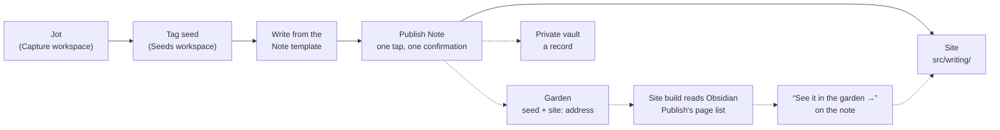

# The writing pipeline

| Field | Value |
|-------|-------|
| Updated | 2026-10-29 |
| Status | **Current.** The record of how writing moves from Drafts to the site, and later to the garden and the private vault |
| Precedence | The live site, then `docs/brand.md`, then this page |
| See also | `docs/updating-copy.md` → "Publishing a note" (the steps), `tools/drafts/` (the action's script) |

## Principles

- **The site is the front door**: the finished word, where someone arrives.
  **The garden** (cognitivearchitecture.ca, Obsidian Publish) is the room
  behind it: thinking, links, the unfinished. Neither replaces the other.
- **Drafts is two things**: the main place to capture, which sends to every
  landing place, and a fallback archive of what was captured, kept for a
  set time.
- **Write once.** One tap sends a note to three rooms, and each gets
  something different (below).
- **Words are edited where they live**: site words from Drafts, garden
  growth in Obsidian, private notes in the vault. The title is the key
  across all three; a retitle changes all three places or none.
- **Stage says how finished the writing is.** It is a word, never a colour.
  Writing reads as "one way I've done this", never the only way.

## The three rooms

| Room | Where | What it receives | Edited afterwards in | Status |
|---|---|---|---|---|
| The site | sebthecanadian.ca/writing/, from `src/writing/<slug>.md` | The finished note: title, body, `type: note`, stage, excerpt | Drafts (re-run the action on the same draft) | Built |
| The garden | cognitivearchitecture.ca (Obsidian Publish) | The note as a seed, with `site:` (its address on the site) in the front matter | Obsidian | Planned |
| The private vault | my.cofolio (Obsidian, never published) | A record, not the text: title, date, site link, wikilink to the garden page, room for private notes | Obsidian | Planned |

## Process map

Solid lines are built; dashed lines are planned.

## How a note is published today

1. **Capture** anything in Drafts (Capture workspace, untagged).
2. **Tag it `seed`** when it's worth writing up; it shows in the Seeds
   workspace, which loads the PROMOTE action group.
3. **Write** from the **Note** template (`# <|Title>`, then `<|Note>`).
4. **Run Publish Note → sebthecanadian.ca** and confirm. The action:
   - takes the first line as the title and the rest as the body;
   - refuses a draft without a title and body, or with a template
     placeholder left in;
   - warns if the text contains any of the caution words kept in the Drafts
     credential (never in the script: this repository is public);
   - commits `src/writing/<slug>.md` to `main` with `type: note`,
     `stage: seedling`, an excerpt and `tags: [note]`; the note is live one to
     three minutes later;
   - remembers which file each draft became (a map in Drafts' iCloud
     folder), so re-running on the same draft updates that note, and refuses
     to overwrite a note made from a different draft;
   - tags the draft `published` and archives it.

**Known limit:** every run writes `stage: seedling`, so updating a note that
was moved on to budding or evergreen resets it. The stage picker (Next round)
fixes this; until then, re-set the stage in the file after an update.

## Decisions

| Date | Decision |
|---|---|
| 2026-10-28 | Writing starts on the site, at `/writing/`, in the nav and on the home page after Now. The garden is no longer where writing starts. |
| 2026-10-28 | Notes are published from Drafts by one action, straight to `main`. |
| 2026-10-28 | Writing is listed by type (`note/`, `post/`) and stage, with a one-line stage key: seedling (a first pass), budding (reworked), evergreen (settled). |
| 2026-10-28 | The action authenticates with a fine-grained GitHub token (Contents read/write, this repository only, expires 28 Oct 2027), stored as a Drafts credential. |
| 2026-10-28 | First note published from Drafts: "Ambiguity is a kind of debt." |
| 2026-10-28/29 | The principles above: front door and garden; Drafts as capture and archive; write once, three rooms; words edited where they live; the title as the key. |
| 2026-10-29 | Caution words move out of the script into the Drafts credential (script v1.2), so the public repository never holds them. |
| 2026-10-29 | The script's canonical copy lives in `tools/drafts/`; this page is the pipeline's record. |
| 2026-10-29 | The garden is a separate vault from my.cofolio. |
| 2026-10-29 | The archive sweep keeps archived drafts 30 days. Only `published` is exempt, so a published note keeps its draft. |
| 2026-10-29 | The 18 archived drafts tagged `work` are left to the sweep. |
| 2026-10-29 | A note can be adopted by its title, so a lost or new draft can still update it: the title is the key. |
| 2026-10-29 | Bluesky posts use the note's first sentences plus the link. |

## Next round

Specified, not built. Each was tested or investigated; the findings are facts.

- **Wikilinks between notes.** `@photogabble/eleventy-plugin-interlinker`
  1.1.2 works on this site: `[[Title]]` resolves by title, `[[Title|words]]`
  works, and backlinks (`backlinks`: `{url, title}`) render well as "Linked
  from" index rows on post pages. Two conditions found by testing:
  1. Keep it away from `src/projects/`, whose figure scripts contain
     `[[ … ]]` arrays: add `src/projects/projects.11tydata.js` exporting
     `{ eleventyComputed: { outboundLinks: () => [] } }`.
  2. A link with a colon to a page that doesn't exist fails the build (the
     plugin reads `prefix:` as a command). The action must check each
     `[[link]]` against the notes already on the site, refuse unknown links
     that contain a colon, and list all unknown links in the confirmation.

  Links to unwritten notes are styled "not written yet". The plugin's
  dead-link report misattributes files; treat it as noise.
- **Stage picker.** When re-running on a live note, the confirmation offers
  seedling / budding / evergreen, preset to the note's current stage (read
  from the file on GitHub). First publishes stay seedling without asking.
  Also a **Garden** workspace in Drafts: archive, tag `published`.
- **Adopt a note by title.** Today a draft can only update the note it made.
  When a draft has no record of a note but one exists at its address, the
  action reads that file's title: if it matches the draft's title exactly,
  the confirmation asks to update the existing note, and on yes the draft
  takes it over, keeping the note's original date (and, with the stage
  picker, its stage). A different title at the same address is still
  refused.
- **Three rooms from one tap.** After the site commit, the action includes
  the existing Drafts actions that write to the garden vault (the full note
  plus `site:` front matter) and to my.cofolio (a pointer note). Vault
  writes happen on first publish only, never on update.
- **"See it in the garden" without a field.** `scripts/garden-rss.js`
  already fetches Obsidian Publish's page list at build time. Reuse it: when
  a published garden page's title matches a note's title, the note shows
  "See it in the garden →". `gardenUrl` stays as a manual override. No dead
  buttons.
- **Share on Bluesky.** A separate Drafts action, run by choice on a
  published note, never automatically. It posts to the real account
  (`com.atproto.server.createSession`, then `com.atproto.repo.createRecord`)
  with an app password stored as a Drafts credential, the link as a proper
  facet, within 300 characters: as many whole first sentences as fit, plus
  the link; title plus link only when not even the first sentence fits. It
  reads the post's address back and writes `blueskyUrl`
  into the note's front matter on GitHub.
- **Archive sweep.** A Drafts action that deletes archived drafts older than
  30 days, except those tagged `published`.
- **Fewer Obsidian actions.** Collapse the eight "New Note →" actions to two
  with a vault picker: "(safe)" writes the body only; "(title)" writes the
  whole draft plus tags. Both name the file after the first line and use a
  vault bookmark.

## Open questions

For Seb to answer; nothing here is assumed.

- Which folder in the garden vault should seeds land in? (That folder
  decides the Obsidian Publish address.) Seb is settling it.
